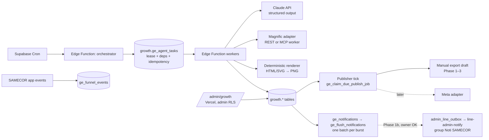

# 02 · System Architecture

## Components

| Layer | Choice | Why |
|---|---|---|
| Scheduler | Supabase Cron, the **only** scheduler | One source of truth; no PC or chat session must stay open |
| Orchestration | Edge Functions + `growth.ge_agent_tasks` queue | State, retries and leases live in Postgres |
| AI | Claude API, versioned prompts in `ge_playbooks`, JSON-schema outputs validated before any DB write | Prompts stay out of the public repo |
| Visuals | `visual_provider_adapter`: `magnific_api` · `magnific_mcp_worker` · `manual_upload` · `mock` | Magnific REST availability on the current plan is unverified |
| Layout | Deterministic renderer (HTML/CSS/SVG) for all text, logo, grid | Thai text must be exact |
| Data | Supabase Postgres schema `growth`, RLS admin-only | Audit, approvals, idempotency in SQL |
| Dashboard | `/admin/growth` inside AdminLayout/AdminGuard | Reuses admin chrome and patterns |
| Publishing | Adapter contract; Phase 1–3 = manual export only | D3 |
| Notifications | Every event → `growth.ge_notifications` → grouped batch → LINE admin group only. Phase 1: mock sender (shown in the dashboard). Phase 1b: reuse `public.admin_line_outbox` + `line-admin-notify` (new kind `growth`) | D4 (updated) |

## Modes (`growth.ge_settings.mode`)

| Mode | AI | Images | Publishing | Use |
|---|---|---|---|---|
| `mock` (now) | mock agent, no network | placeholders | simulated export | build + demo |
| `test` | real Claude, small caps | real Magnific | export only, never posted | Phase 2 |
| `live` | real | real | approved jobs only, one channel at a time | Phase 3+ |

`pause_all` overrides every mode.

## Phase 1 implementation (this PR)

The dashboard runs entirely on `src/lib/growth/mockData.ts` through an in-memory store (`store.tsx`) wrapping the pure engine (`engine.ts`). Nothing reads or writes Supabase, so it works before the migration is applied. Phase 1b swaps the store for Supabase queries against `growth.*` once the owner approves the migration.

## Data flow for one campaign

`signal → brief → drafts + visuals → per-platform variants → QC → AWAITING_APPROVAL → (comment → revision vN+1 → QC → AWAITING_APPROVAL)* → approve per platform → schedule (jobs bound to hashes) → publisher tick → manual export → owner posts + pastes URL → metrics at 24h/72h/7d → weekly memo → next brief`.
